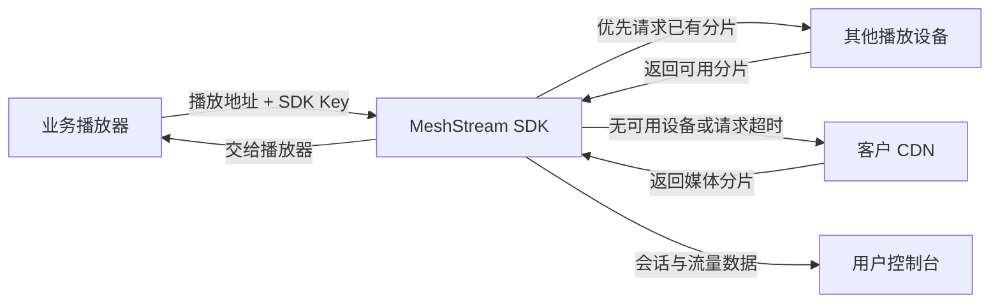

import Link from '@docusaurus/Link';

# 工作原理

MeshStream 不替换客户现有的播放器、源站或 CDN。SDK 为每次播放创建独立会话，在播放器和媒体网络之间协调分发路径：能够从其他播放设备获取时优先复用已有分片，否则继续从客户 CDN 获取。

## 一次播放的完整流程

播放过程由 SDK 自动完成：

1. 播放器把原始 HLS 或 DASH 地址交给 SDK，并传入 SDK Key。
2. SDK 根据应用和内容识别播放会话，让观看同一内容的设备具备复用条件。
3. 每个分片请求根据可用设备、网络状态、播放器缓冲和响应速度选择来源。
4. 从其他设备获取的分片计入 P2P 下载流量；无法获取时自动从客户 CDN 获取。
5. 会话结束后，SDK 异步记录流量、连接和降级信息，客户在控制台查看结果。

## 两种分发路径

### 从其他设备获取

当同一应用下有其他设备已经获取了相同内容，并且网络条件允许连接时，SDK 可以从这些设备获取媒体分片。设备分享的上传流量不计 MeshStream 额度。

### 从客户 CDN 获取

以下情况会继续使用客户 CDN：

- 当前没有可用的其他设备；
- 网络环境不适合设备间连接；
- 分片请求超时或返回异常；
- SDK Key、应用策略或服务暂时不可用。

CDN 路径是播放兜底，不会因为加速能力暂时不可用而中断播放。CDN 回源流量由客户继续按照自己的 CDN 服务商规则结算。

## 对播放器的影响

- 播放器继续负责 HLS/DASH 清单解析、ABR、解码和渲染；
- 业务代码应播放 SDK 返回的 `playbackUrl`，不要重新拼接原始地址；
- 源站的签名 URL、Cookie、请求头和 DRM 策略继续由客户控制；
- 播放地址带动态签名时，可以传入稳定的 `contentId`，帮助不同会话识别同一内容；
- SDK 的加速状态不应作为停止播放的条件。

## 计量口径

| 数据 | 含义 | 是否扣 MeshStream 额度 |
| --- | --- | --- |
| P2P 下载流量 | 本设备从其他播放设备获取的媒体流量 | 是 |
| P2P 上传贡献 | 本设备向其他播放设备分享的媒体流量 | 否 |
| CDN 回源流量 | 本设备从客户 CDN 获取的媒体流量 | 否 |

命中率按 `P2P 下载流量 / (P2P 下载流量 + CDN 回源流量)` 计算，用于观察加速效果，不代表播放器只能使用其中一种路径。

## 接入后的验证方式

1. 使用同一应用下的 SDK Key 播放同一内容，确认播放器播放的是 SDK 返回的 `playbackUrl`。
2. 在控制台观察播放会话、Peer 数量和 P2P 下载流量。
3. 临时关闭 P2P 或断开网络，确认播放器仍能通过客户 CDN 完成播放。

下一步：[快速开始](../quickstart.md) · [SDK 接入](../sdk/web.md) · [统计与用量](./statistics.md)

## 场景与效果验证

- <Link to="/solutions/live-streaming">直播 P2P CDN 方案</Link>：先判断同内容并发、网络和延迟条件，再设计灰度与 CDN 回退验证。
- <Link to="/guides/reduce-video-cdn-cost">视频 CDN 成本优化与分流测量指南</Link>：区分分流字节与净成本，按可比业务窗口评估效果。
